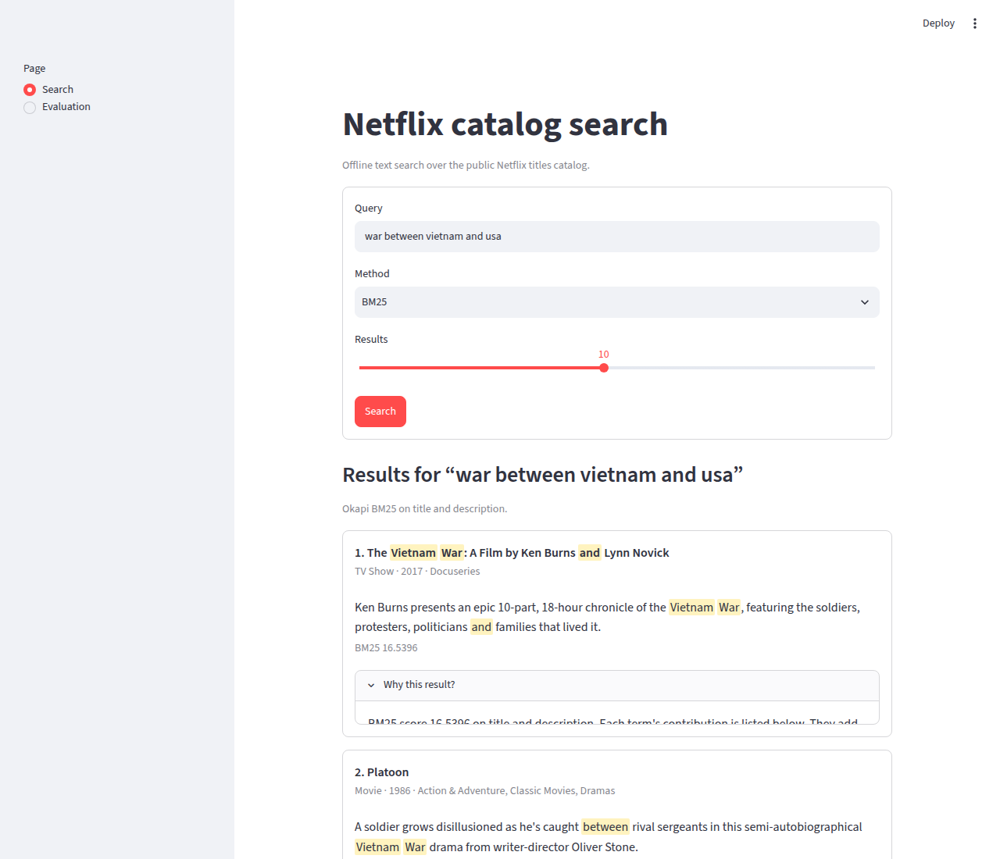

# Netflix Catalog Search

Search 7,787 Netflix titles by plot, cast, genre and setting. This project compares six retrieval methods, from Boolean matching to a cross-encoder that reranks the strongest 50 candidates from BM25 and MiniLM.

**[Explore the held-out rankings in your browser](https://nikosmav.github.io/netflix-catalog-search/)** · [Read the retrieval case study](RETRIEVAL.md)

## What changed the rankings?

For “British gangster series set after the First World War,” both BM25 and hybrid fusion missed *Peaky Blinders* in their top ten. Reranking moved it to first. Its catalog card describes a gang in Birmingham in 1919. For the karate rivalry query, all three systems already had *Cobra Kai* first. Reranking lost a little ground further down the list. [Compare the gangster query](https://nikosmav.github.io/netflix-catalog-search/?q=birmingham_gangsters#rankings) · [Compare the karate query](https://nikosmav.github.io/netflix-catalog-search/?q=karate_sequel_series#rankings)

<!-- EVAL_V2_NOTES_BEGIN -->
Hybrid + rerank beat BM25 on **27 of 30 queries**. The mean nDCG@10 gain was **+0.2655** (paired 95% bootstrap interval **+0.1728 to +0.3644**). Fusion alone gained +0.0763, with an interval spanning zero (-0.0109 to +0.1656).

An LLM graded shuffled catalog cards with system names and ranks hidden. The intervals resample queries and treat their grades as fixed.

A second LLM reviewed **303 of 3,032 pairs**. The judges agreed on the exact grade for 83.2% and on relevance (grade 2 or 3) for 98.0%. Substituting the second grades on the sampled test cards gave a reranking gain of **+0.2587** versus BM25 (paired 95% interval +0.1670 to +0.3559).
<!-- EVAL_V2_NOTES_END -->

<!-- METRICS_TABLE_BEGIN -->
| System | nDCG@10 | Recall@10 |
| --- | --- | --- |
| boolean | 0.419 | 0.5701 |
| tf-idf | 0.4973 | 0.6437 |
| bm25 | 0.544 | 0.6937 |
| dense(title+desc) | 0.5391 | 0.6517 |
| hybrid(bm25+dense,meta) | 0.6202 | 0.7393 |
| hybrid+rerank | 0.8094 | 0.9002 |
<!-- METRICS_TABLE_END -->

nDCG@10 gives more credit when a highly relevant title appears near the top. It covers all 30 held-out queries. Recall@10 counts titles graded 2 or 3 and covers the 29 queries with at least one such title in the judged pool. The 28 development queries informed configuration choices. Both splits use queries written for this catalog. [Full results and limitations](RETRIEVAL.md#evaluation-v2) · [Frozen rankings](results/eval_v2/top10.json) · [Scoring protocol](configs/eval_v2.yaml)

## Search the catalog locally

From a clone of this repository, create and activate a Python 3.10+ virtual environment, then run:

```bash
python -m pip install -e ".[ui,dev]"
python -m retrieval query "British gangster series set after the First World War" --method bm25
python -m streamlit run app/streamlit_app.py
```

The Streamlit app accepts your own queries. Open **Why this result?** to inspect term contributions, fusion ranks or movement after reranking. BM25 runs immediately with the bundled catalog. The first neural query downloads the MiniLM models and builds an embedding cache.



## Reproduce the evaluation

```bash
python -m pytest
python scripts/build_explorer.py
python scripts/eval_v2_spotcheck.py draw
python -m scripts.score_second_judge
```

The explorer builds from committed rankings with Python’s standard library. Open the printed HTML file to use it offline. The sample command verifies the original blinded draw. A fresh model run with `python scripts/run_eval_v2.py` writes its rankings, metrics and counts of unjudged results to `.cache/eval_v2/`.

The second-judge command recomputes agreement, the grade confusion matrix, per-system comparisons and the held-out sensitivity analysis. Each reviewed pair includes a written reason for its grade. [Audit findings](RETRIEVAL.md#second-judge-findings) · [303 grades and reasons](data/eval_v2/spotcheck_second_judge.json) · [Machine-readable results](results/eval_v2/second_judge_audit.json)

The [original analysis notebook](netflix_data_analysis.ipynb) covers exploratory analysis and sparse search. The [retrieval walkthrough](netflix_dense_retrieval.ipynb) exercises the package.

## Data and license

The catalog is the public Netflix Movies and TV Shows dataset distributed by
[Shivam Bansal on Kaggle](https://www.kaggle.com/shivamb/netflix-shows) and mirrored
by [TidyTuesday](https://github.com/rfordatascience/tidytuesday/tree/master/data/2021/2021-04-20).
Provenance and IMDb-join caveats are documented in [`data/README.md`](data/README.md).

Code is released under the [MIT License](LICENSE). Netflix catalog content remains
the property of Netflix; IMDb-derived data is subject to IMDb's non-commercial terms.
Wikipedia plot text in [`data/wikipedia_plots.jsonl`](data/wikipedia_plots.jsonl) is
[CC BY-SA 4.0](data/WIKIPEDIA_ATTRIBUTION.md).
